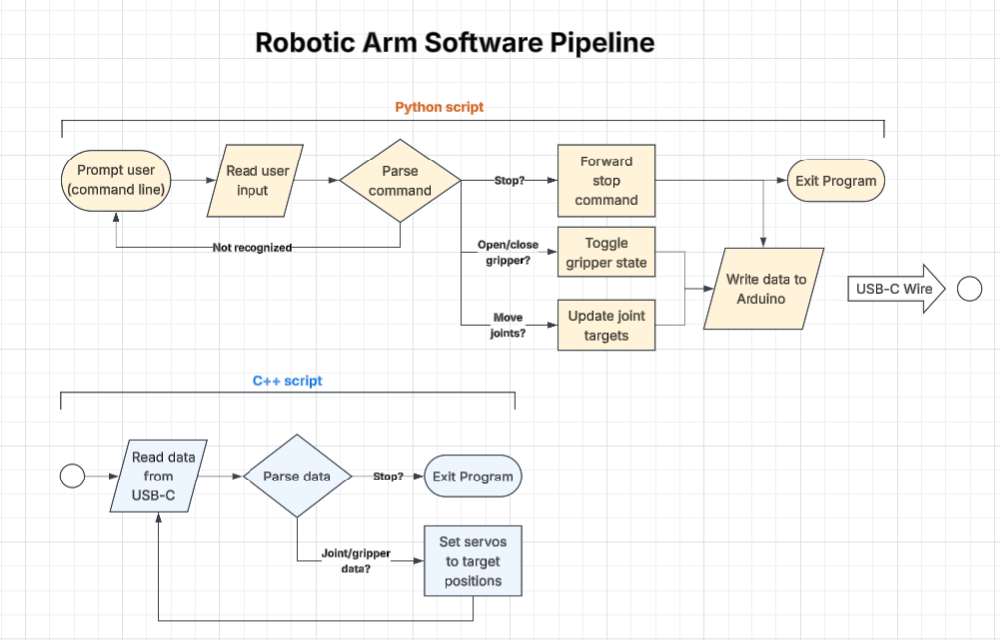

# Robotic Arm 
A 5 DoF robotic arm with a gripper at the end to move small objects around 

# the Problem 
I've always wanted to have my own robotic arm, because I think they are REALLY COOL. Especially the math to be implemented in the software to make the end effector move linearly. Also, I've worked a ton on the software side of robotics, but less so on the electrical side, and much less on the mechanical side. So, it seems obvious that in order to fill this gap of knowledge and to satiate my curiosity, I should make one. 
And so I will. 

# How It Works 

### Project goal: 
Build, wire, and program this arm to lift objects up to 100 grams in weight 

### Minimum Viable Product: 
1. Mechanically working arm 
2. Safe and working power circuits and signal circuits to power and send data to each servo 
3. Teleoperation functionality of arm through command line input 

### Future Plans: 
1. Add gamepad control over arm 
2. Set up inverse kinematics algorithm so that user can control end effector position instead of joint angles 

### Tech Stack: 
 - Python script to read user input and send to arduino
  - C++ script to read python data and relay to servos

## Author
Kevin Chen, https://github.com/kc0817